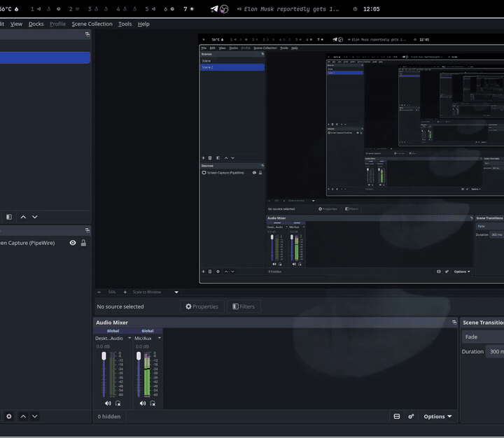

# Synapse

Synapse is a local workspace for exploring open language models with a human and
a coding agent. Browse neurons in a 3D map, inspect what fires on your text, and
compare model outputs with and without an intervention. **Codex CLI and Claude
Code** can work alongside you through MCP tools that read the same checkpoint
and control the shared view.

[](docs/media/synapse-demo.mp4)

*From Amarion's October 26, 2026 recording: navigating the Qwen3.5 neuron map,
with selected-neuron token labels and connection links visible.*
[Watch the MP4 excerpt](docs/media/synapse-demo.mp4).

## What you can do

- **Explore a neighborhood.** Select a neuron to see its token labels and ranked
  upstream/downstream links. Follow a neighbor or expand the map to two or three
  hops. Links are weight-alignment hypotheses to investigate, not proven circuits.
- **Read a model's response to text.** Inspect per-token activations, find strongly
  firing neurons, and compare candidates across prompts and controls.
- **Test interventions.** Add to or multiply selected neuron activations, compare
  steered and baseline continuations, and measure next-token probability changes.
  Supported adapters also expose whole-MLP and attention-head ablations.
- **Investigate with an agent.** In the Agent tab, ask Codex or Claude to inspect
  neurons, run supported probes, select or highlight candidates, move the camera,
  and write experiment scripts. Tool calls and results appear in the conversation.
- **Browse quantized weights without loading inference.** The Qwen3.5 GGUF backend
  computes missing links and logit-lens labels from the file's own weights.
  Hover is cache-only; activation and generation probes load inference separately.
- **Keep results tied to the model.** Checkpoint/revision identity separates caches,
  calibration and neuron names. The server reports supported operations and loaded
  state; the agent model is separate from the checkpoint under investigation.
- **Explore residual interventions (experimental).** The research API implements
  selected-layer residual capture, reversible projections and factor-archive
  exports. See the [API and live-validation status](docs/RESIDUAL_PROJECTION.md).

## Start from the checkout

Use Python 3.11+ and [uv](https://docs.astral.sh/uv/). From the repository root:

```bash
uv sync
uv run python scripts/synapse.py serve --model HuggingFaceTB/SmolLM2-135M-Instruct
```

Open **http://127.0.0.1:8791** in a WebGL2-capable browser. The server starts
without loading model weights. Use **synapse → Load model for live experiments**
or request an activation/steering probe to load them. The first use may download
the checkpoint; allow disk space and RAM. The default dependency configuration
uses CPU PyTorch.

To use the Agent tab, separately install and authenticate Codex CLI or Claude
Code, then choose that provider in the UI. Synapse connects its MCP tools
automatically. Agent conversations use the provider's configured model; they do
not turn the inspected local model into the coding agent.

See [Operations](docs/OPERATIONS.md) for model selection, the optional Linux user
service, GGUF setup, agent configuration and verification. These commands use the
repository launcher; `uv sync` does **not** install a global `synapse` command.

## Model support

| Path | Scope |
| --- | --- |
| Hugging Face Transformers | Structural adapters for supported dense decoder layouts, including Llama, Mistral, Qwen2/3/3.5, Gemma2, GPT-2, GPT-NeoX, OPT and Phi3. Small architecture tests cover capture and interventions; available lens, connection and head operations depend on the adapter. |
| Native GGUF, CPU | Qwen3.5 with pinned llama.cpp b11669; inspection and neuron steering have been exercised on Qwen3.5-4B Q4_K_M. Other GGUF architectures, GGUF head ablation and a whole-model GGUF lens index are not implemented. |
| Bundled author map | Lyra's precomputed Qwen exhibit, viewable without loading weights. It is kept separate from live checkpoints. |

Compatibility is checked from structure and dimensions, not just the model name.
MoE, encoder-decoder and unsupported packed/quantized Transformers projections
need additional adapters. Consult the running server's `overview` MCP tool or
`/api/agent/overview` before choosing a probe.

## Experimental research API

The [residual projection API](docs/RESIDUAL_PROJECTION.md) implements bounded
residual capture, request-scoped projection interventions and export of
checkpoint-bound factor archives. This is an experimental Qwen3.5 research path:
live integration validation is still pending. Factor archives are Synapse callback
adapters, not merged GGUF files or standard llama.cpp LoRAs.

See the [research agenda](docs/RESEARCH_AGENDA.md) for experiment design, controls
and evaluation.

## Foundations and credit

Synapse builds on [Lyra's neuron-explorer](https://github.com/lyramakesmusic/neuron-explorer):
the map, lens, activation/steering interface and Claude-assisted exploration form
its foundation. Synapse extends that workspace with Codex integration, checkpoint
selection and dense adapters, isolated model state, native quantized-weight
inspection and the experimental residual research API.

The [upstream README](docs/UPSTREAM_README.md) is preserved from revision
`f79b2196e29aacbad89684938baac8d97b172fd1`. No license file was present in that
snapshot; this fork does not assign a license to the upstream code or data.
