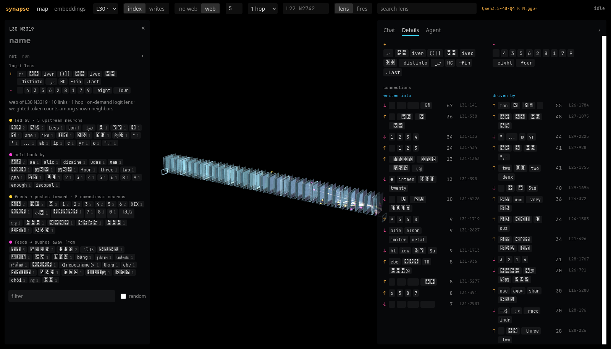

# Uncached GGUF inspection repair — reviewed, deployed and published

Repository: /home/park/Projects/synapse. Reviewed, deployed and published candidate: f22f2239d489acaad42754c8e0955d5e188ea4a9, based on c4c270b1533fbcd03e4fe0f968da03dae6e14ef5. Independent review: PASS, no blocking product defect; the browser addendum closes the sandbox coverage gap. git push origin main succeeded and git ls-remote verified the exact same remote hash at 11:52Z. Publication receipt: evidence/uncached-repair-publication.json. Review-return obligation qitem-20261026114915-2a358248 carries final integration to operator-agent@kernel. The remaining full-inference baseline limitation is stated below.

## Changed behavior

Cold GGUF links, lens and webs use a vocabulary-only llama model and read-only mmap with bounded dequantization/page release. No generation context or inference lease is allocated. Inference admission and its shared CPU slot remain in force. Hover reads existing cache entries only. Selection changes clear old data, abort outgoing requests and reject late responses by request identity, including A→B→A navigation. The server skips disconnected requests before entering the serialized scan worker.

Product files: README.md, explorer/gguf_runtime.py, explorer/llama_bridge.py, explorer/runtime.py, explorer/server.py, explorer/static/app.js, native/llama-bridge/bridge.cpp, scripts/verify_gguf_inspection.py, tests/test_inspection.py. Local launch/workflow files and machine artifacts are excluded from the commit.

## Builder verification

- Original failure reproduced: L31 N7066 connections HTTP422 required 4352 MiB while only 3689 MiB was available. The earlier cached-neighborhood receipt did not establish arbitrary selection behavior.
- 32 regressions pass: evidence/gguf-inspection-regressions.txt. Targeted cold-connection and hover tests failed before implementation. Added cancelled-running-worker and disconnected-queued-request coverage. JavaScript syntax and staged whitespace checks passed.
- Native bridge rebuilt using installed pinned llama.cpp b11669 headers/runtime, no downloads. First attempt failed because vocab_only omits llama architecture hparams; corrected by reading validated GGUF metadata dimensions. Raw failure: evidence/gguf-inspection-native.log and .synapse/verification/inspection-mm97kojg/result.json.
- Actual checkpoint, new empty cache, inference explicitly prohibited: L0 N113, L15 N417 and L31 N7066/N7621/N4089/N2565/N6399/N7166 all passed links, lens, graph and summary. Starts with 3367.875 MiB available; peak process RSS469.535 MiB. Scalar and batched lens labels agree. Native inspection rejects inference with no context. Receipt: .synapse/verification/inspection-y4itj1py/result.json and reference.npz; log evidence/gguf-inspection-native-v2.log.
- GGUF hash after checks is unchanged: 00fe7986ff5f6b463e62455821146049db6f9313603938a70800d1fb69ef11a4.
- Builder isolated Firefox attempts timed out before initialization and selected no neuron. Reviewer separately demonstrated unavailable WebGL2 in its sandbox. Preserve evidence/gguf-inspection-browser-1.json and -v2.log/-v3.log, evidence/review-f22f223-browser-sandbox.json, -sandbox.png and -geckodriver.log. These are failed environment runs, not browser passes. Builder test Firefox sessions were deleted; driver4448 and fixture8792 were stopped by exact exec-session interrupts, with ports subsequently refusing connections. Cleanup: evidence/gguf-inspection-cleanup.json. Successful external production browser checks are recorded below.

## Independent review and production acceptance

- dev-review@starter reviewed the exact nine-file diff and independently passed 32 regressions. A separate initially empty cache passed early/middle/final selections with inference forbidden and 3165.602 MiB available; peak process RSS468.465 MiB. Independent NumPy products agreed with native upstream/downstream vectors within 8.77e-10 / 1.69e-9 maximum absolute error. Scalar/batched labels agreed, inspection rejected inference, and model hash was unchanged. Receipts: evidence/review-f22f223-verdict.md, -pytest.txt, -native.json and -native-v2.log.
- Reviewer production HTTP checks returned pending empty previews for three uncached hovers without changing 443 cache rows. Invalid coordinates returned422. Receipt: evidence/review-f22f223-http.json. The worker cancellation/disconnected queue regression passed.
- Parent codex-synapse@external deployed the frozen candidate on live8791 and independently exercised six initially absent coordinates after restart: sequential early/middle/final selections followed by rapid cross-layer switching. The last selection owned the displayed links/labels, and no JavaScript errors occurred. Inference stayed unloaded and inspection became loaded. Receipts: evidence/uncached-parent-acceptance.json, .log and evidence/uncached-parent-browser.png. Builder and reviewer inspected the supplied results after completion; neither read nor ran the reserved acceptance script.
- Parent then ran the reviewer-authored evidence/review_f22f223_browser.py externally against production using an owned Firefox driver. Forced delayed A→B→A kept marker2 and the final focus/lens/web at L15 N417. Six actual pointer-hover requests hit /api/hover only, with no connections/lens/web scans and no JavaScript errors. Receipts: evidence/review-f22f223-browser.json and -browser-external.log. The old sandbox failure is preserved under the -browser-sandbox names. Parent reports this browser driver/service stopped.
- Deployment binding: evidence/uncached-parent-deployment.json records exact full commit, matching product tree, active service PID749593 and invocation50b7b132ba9d4c8194e50c64314538d0. Native library SHA256 f23695b8866ef4928c7f4921a822da363d477e35c59ec05d5dbc5a2a0d449f86 matches the independent native check. Live MCP overview rechecked by builder at11:50Z still reports checkpoint2ab8b6b51ed3457079cd, idle, inference_loaded=false, inspection_loaded=true.
- Parent host measurements: MemoryMax5368709120, MemorySwapMax0, cgroup peak1296687104 bytes (1236.617 MiB, about1.21 GiB), swap0; post-acceptance process RSS526784 KiB. These describe this bounded production acceptance run and include different accounting from standalone native peak RSS. Available RAM before browser acceptance was3516496 KiB, below inference admission.

The reviewer inspected the supplemental browser results and reaffirmed PASS in evidence/review-f22f223-browser-addendum.md. Operator then independently measured the same service invocation at 11:53Z: active/running, lifetime cgroup MemoryPeak 1733156864 bytes (about 1.61 GiB), swap 0, MemoryMax 5368709120, MemorySwapMax 0, CPUQuotaPerSecUSec 3s. This later lifetime peak includes the supplemental checks and must not be conflated with the earlier 1.21 GiB cold-browser window. The separate qwen-openweights-lab.service was inactive/dead, MainPID 0. Host receipt: /home/park/.local/state/synapse-uncached-repair-20261026/operator-deployed-service-check.json.

## Remaining limit and continuation

Full-inference reference comparison and before/after baseline logits were not rerun for f22f223. The 4352 MiB admission guard and shared inference lease remain intact; neither was bypassed. Historical baseline/logit results remain historical. The bounded optional scripts/verify_gguf_inspection.py --reference mode is the continuation when coordinated memory permits it, with model services stopped and the service memory bound applied. This is an explicit verification residue, not a claim that fresh baseline equivalence was measured.

Builder/reviewer sandboxes cannot reach the host user bus; deployment/resource claims use the parent's host receipts. Namespace-local test PIDs are not used as cross-process RSS evidence. Native RUSAGE is valid. Heavy native/browser runs were serialized, including an interrupted reviewer run retained in evidence/review-f22f223-interruptions.md.

Local AGENTS launch additions, .agents, missions and ignored machine records remain outside the product commit. No models, credentials, caches or chats are published. No unrelated applications were stopped, saved weights edited, broad sweeps run or dependencies downloaded. README/capabilities describe the new behavior; DECISIONS.md and evidence/synapse-verification.json retain these evidence boundaries. Final delivery goes through the existing review-return row to operator-agent@kernel.

## Media

